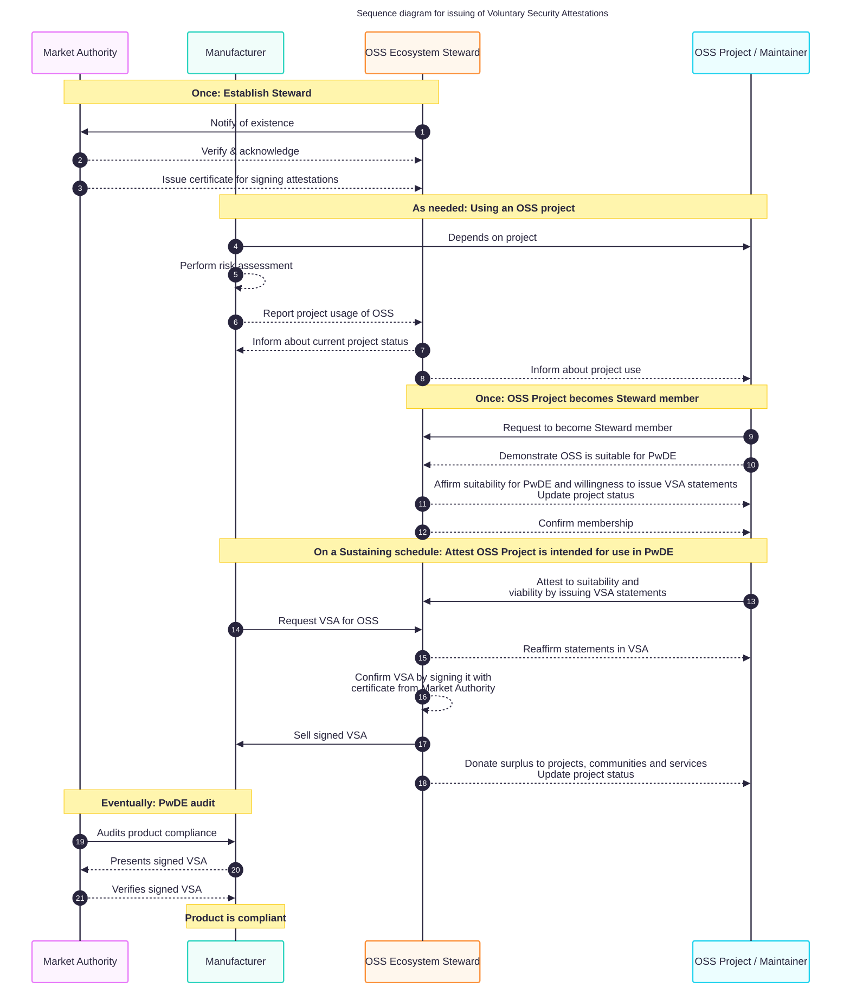

## The concept, in three sentences

* A maintainer's co-op, owned by the people who serve and take cake of an volunteer-based software ecosystem's projects,  services, and communities.
* Companies pay it for proof that the code and ecosystem they rely on is looked after, and the money goes back to the people who look after it.


## Summary

The EU Cyber Resilience Act (CRA) makes manufacturers responsible for the security of _every_ component in their products, including the Open Source ones.
Many of these businesses will need help from the Open Source projects they depend on to become and remain compliant.

The CRA introduces a new kind of organization to provide this help: the _Open Source Software Steward_.
A Steward works well for a foundation supporting tens or hundreds of projects, but an ecosystem like CPAN has _tens of thousands_ of projects, and no existing organization able to take on the role.

This document proposes a variant of this organization, designed for that scale: the **OSS Ecosystem Steward**.

### Key features

* **Community-owned** – owned by ecosystem participants: the project maintainers, service administrators and community organisers who choose to join.
* **Co-operative** – democratically governed, with voluntary, opt-in membership that allow ecosystem participants leave and rejoin.
* **Non-profit** – any surplus goes back to the projects, services and communities in the co-op and the ecosystem.
* **Funded by manufacturers** – mainly through enrollment fees and recurring _Voluntary Security Attestations_, which help manufacturers show market authorities that the Open Source projects they rely on are viable for use in their products.
* **Dedicated to improving the long-term sustainability and security posture of it's OSS communities** – by donating enough of it's surplus to fund at least one day per week per maintainer, administrator or organizer.

The rest of this document explains why this is needed and how it could work:

1. [Background](#background-the-cra-and-open-source) – what the CRA requires, and what that means for Open Source communities
1. [What is an Open Source Software Steward?](#what-is-an-open-source-software-steward) – and why the role is hard to fill for an entire ecosystem
1. [Designing a Steward for an ecosystem on the community's terms](#designing-a-steward-for-an-ecosystem-on-the-community-s-terms) – guiding questions and design criteria
1. [The proposal](#the-proposal-a-community-owned-non-profit-co-operative) – a community-owned non-profit co-operative
1. [Funding model](#funding-model) – revenue sources for creating a surplus


## Background: The CRA and Open Source

When the [(EU) Regulation 2024/2847 (Cyber Resilience Act)] comes fully into effect on 11 December 2027, businesses that want to be compliant must perform a number of security-related tasks for each of their CE-marked products, and for the remote data processing solutions those products rely on.

### What is in scope?

The details of what is in scope are beyond this document, but the [CRA Guidance] (e.g. [CRA Guidance chapter 2]) and the [CRA FAQ] (e.g. [CRA FAQ 1.1.2]) cover it in depth.

In short, the CRA applies to _both_ digital and physical products placed on the EU market _in the course of a commercial activity_.
This includes their remote data processing solutions – e.g. online services or APIs the product needs to function as expected.

_This includes phone apps, their server components, and any other solutions used to keep the product updated, secure and compliant_.

## The problem: Manufacturer obligations that reach upstream Open Source projects

The complete set of manufacturer obligations are also beyond the scope of this document, but the most important ones are laid out in [Article 13], [Article 14], [Article 64], [Article 69], [Annex I, Part I], [Annex I, Part II], [Annex II], and [Annex VII].

Many of the obligations falling on the manufacturer have implications for the Open Source communities in use. Some of the most important one are:

| Obligation on the manufacturer | Example implication for upstream Open Source |
|---|---|
| The product must have a support period that matches its expected use (e.g. 5 years). ([Article 13(8)]) | Any Open Source component used in the product, or in its remote data processing solutions, should be supported for the same period. |
| Security updates must remain available for 5 years after the support period ends. ([Article 13(9)]) | Software update services that depend on Open Source should be kept secure for an _additional 5 years_. |
| The product must have no known exploitable vulnerabilities while it is on the EU market. ([Annex I, Part I] (2)(a)) | The product must be updatable for its entire support period, including with relevant updates from its Open Source components. |
| Product metadata (including the SBOM) must be complete, correct and not misleading. ([Article 64(4)]) | Metadata must be kept current with upstream projects, e.g. changes in ownership, project name, version number schema, license. |
| Vulnerabilities and fixes found must be shared with the upstream maintainer. ([Article 13(6)]) | Someone upstream needs to be available to receive, adopt and apply these fixes, ideally in a timely manner. |
| The manufacturer is responsible for the security of the _entire_ product. ([CRA FAQ 4.1.1], [CRA FAQ 4.3.6]) | This _includes_ the Open Source components used in the product and in its remote data processing solutions. |
| The manufacturer must perform a cybersecurity risk assessment, and exercise _due diligence_ when integrating components. ([Article 13], [Article 14]) | Depending on the number of products and their risk profiles, due diligence may cover _hundreds_ or _thousands_ of Open Source components. It also covers the long-term security posture, viability and concerns around the governance of those components – for the entire support period. |
| Market Surveillance Authorities may evaluate the product, and if corrective action is insufficient, require it to be withdrawn or recalled from the market, or issue fines. ([Article 52], [Article 54]) | If a vulnerability in a product is discovered and exploited before the manufacturer has its _ducks in a row_, this can quickly become expensive. |

### The choice facing Open Source ecosystem participants

From the examples above, we should expect that many businesses using Open Source may be unwilling or unable – or simply lack the resources – to become and remain compliant without at least _a minimum_ of involvement from the OSS ecosystems they rely on.

This forces the project maintainers, service administrators and community organisers in these ecosystems into a [Hobson's Choice]:

1. Either they take steps to demonstrate that their project is _intended for use in the course of a commercial activity_,
1. or they do not – and risk that a (possibly significant) share of their users are forced to switch to alternatives that allow them to remain compliant.

Declining has security consequences for everyone using the project.
Accepting brings a lot of boring and tedious compliance work.
Neither option is attractive, and in the end, each maintainer has to decide for themselves.

From a security perspective, our common goal should be to make the choice realistic, and fair, so to increase the likelihood that more maintainers choose to accept it.
But this quickly encounters issues from scaling this up to an ecosystem level.
Here is where the _Open Source Software Steward_ has a critical role to play.


## What is an Open Source Software Steward?

The CRA defines a new legal category – the _Open Source Software Steward_ – in [Article 3]:

> […] a legal person, other than a manufacturer, that has the purpose […] of _systematically providing support on a sustained basis for the development of […] free and open-source software […] intended for commercial activities, and that ensures the viability of those products.

(For details, see [Recital (19)], [Article 24], [CRA Guidance chapter 3] and [CRA Guidance section 3.3].)

In practice, the Steward's main purpose is to help Open Source projects improve their long-term security posture, and their viability for use in CE-marked products.

### Why this is hard for an entire ecosystem

For smaller, well-organised communities – e.g. those already supported by a foundation – the Steward's tasks are quite manageable. 
Even the largest Open Source foundations support projects numbering in the tens or hundreds, and even then they have the benefit of being able to impose policies onto the projects in their care.

For an _ecosystem_ like CPAN, the picture is very different.
CPAN alone has _tens of thousands_ of projects, and would struggle to meet even the basic expectations of the CRA described above.
Even if we only consider the hundred of projects most likely to be used in _Products with Digital Elements_ (PwDE – the CRA's term for the products it regulates), there remains a long tail of smaller projects that are in use.

To make it worse, there are further complications for CPAN specifically:

* **No existing candidate** – The greater CPAN ecosystem has no existing organization that is willing, competent and able to take on the Steward role.
* **A laissez-faire tradition** – The CPAN community has long operated in a _laissez-faire_ way, letting each individual decide for themselves whether to act or not. Any Steward must respect this.
* **A fiercely independent culture** – Many maintainers look with scepticism at any centralizing "authority", which has been acknowledged for decades with the Perl Foundation's "hands-off" and "servant leadership" philosophy for supporting the community. Imposing even basic requirements like security policies or viability requirements on projects, is therefore quite unrealistic.

So instead of trying to fit the Steward's tasks onto existing governance structures, we ask a different question:

**How do we apply the Steward function to an entire ecosystem _on the community's terms_?**


## Designing a Steward for an ecosystem on the community's terms

Here, the answer is to _create an entirely new organization_, designed from first principles for a global, laissez-faire, distributed and heterogeneous communities of communities – like the Perl and CPAN ecosystem.

### Guiding questions

* With awareness of the existing traditions, values, habits and culture of the ecosystem: what type of organization would align best with these?
* What communities, organizations and governance structures exist already, and how can we include them as participants, regardless of their role in the ecosystem and their organizational maturity?
* Which communities would also benefit from support, but are usually forgotten?
* How can we make every part of the Steward function _voluntary_ and _opt-in_, so that all parties are free to join, leave and rejoin as they wish?
* Which demands on the communities are strictly necessary, and what structures must the Steward have in place to support those demands on a sustained basis?
* How can we minimize the scope and demands placed on projects, as well as motivate them to take part in the requirements that remain?
* How can we do all this, while each individual remains fully in control of the projects, services and communities in their care?

### Design criteria

From these questions, we arrive at the following criteria.

1. **Be a non-profit**, dedicated to supporting its communities.
1. **Be community owned**, allowing individuals and communities affected by CRA to have a say in how this may affect them positively.
1. **Be governed fairly**, through a transparent and democratic decision-making structure.
1. **Limit its scope** so it only applies to projects, services and communities that are _actually in use_ by manufacturers, or that otherwise offer a service benefiting the community.
1. **Be freely joinable and leavable** at will by anyone in the community affected by the CRA.
1. **Limit imposing obligations on members to the minimum** required so they may continue managing their projects as they wish, but from now with project viability, security and compliance needs of their users sufficiently covered.
1. **Operate as a business**, generating a surplus by selling compliance-relevant security attestations, capable of sustaining its communities through donations.
1. **Work well with outside parties** to fulfil its obligations towards market surveillance authorities, manufacturers and others.
1. **Do not accept donations** and instead aim to create an _additional_ source of funding, suitable for OPEX budget line items of manufacturers wishing to remain compliant.
1. **Be able to support others** inside, upstream and downstream of the ecosystem – including projects, services and communities we rely on, but that are easily forgotten or "hidden" in the dependency graph.
1. **Ensure member projects, services and communities remain fully self-owned and independent** so that members remain in control of their project.


## The proposal: A community-owned non-profit co-operative

An _OSS Ecosystem Steward_ is a community-owned non-profit co-operative, set up to support the people in the ecosystem who are affected by the CRA, and who wish to help improve their users' security posture.

### Community owned

The project maintainers, service administrators and community organisers who _voluntarily choose to opt in_ become the _owners_ of their Ecosystem Steward.
Here, it is important to acknowledge that Open Source projects are not alone in ensuring the overall health and security posture of their software and ecosystem.
If you are an active participant in the ecosystem, and affected by the CRA, you may apply for membership.

* **Project maintainers** – because the security posture of their projects (and the resulting component releases) is at the centre of the manufacturers' concerns, and is where manufacturers are likely to find their largest compliance-related costs.
* **Service administrators** – because manufacturers and maintainers alike rely on their services to publish, identify, download, resolve, test, discuss and learn about the software they use. These services have to remain available and secured for everyone using them.
* **Community organisers** – because there is no real Open Source without the meetings, conferences, workshops, summits, tutorials, stands and other venues where networks of trust and support are built, where we can learn and teach the skills we need.

### Non-profit

Open Source relies heavily on volunteer spirit, and on individual motivation to create something cool or make something cool happen.
In Norway, we call this spirit "Dugnad" or "Dugnadsånd" – the willingness to help your neighbours improve something you share, or something placed in _the commons_.
Clean up the neighbourhood after a long winter.
Renovate the local children's playground.
Or, for your _digital neighbours_: contribute a fix for a vulnerability, organise a conference, or run a service everyone relies on.

Many activities are central to our communities' overall health, and are almost always done by volunteers.
And some of this work is hard – even impossible – to find volunteers for, because it is "too boring", "too tedious" or just unappealing.
For that work, we need support mechanisms that motivate people do it anyway – for example funding that makes it possible to spend one weekday (20% FTE) on Open Source.

Many of us contribute to Open Source as a break from corporate and for-profit life.
So the Steward should _not_ support these communities like a regular for-profit business would.
Ecosystem participants are are not hired, and don't receive a wage – they are non-profit or individual, independent co-owners, receiving donations without any strings attached.
And to ensure that the OSS Steward MUST NOT become just another way to extract value from the Open Source communities it supports, we make it also a non-profit.
And to do this without imposing the parts of corporate life many of us wish to have a break from.

Conveniently, the CRA also encourages Open Source Software Stewards to operate as non-profits.

As a non-profit, the Steward must use any surplus on:

1. **Member support donations**, according to a disbursement formula decided by the General Assembly.
1. **Non-member support donations**, according to a disbursement formula decided by the General Assembly.
1. **Re-investment into the Steward itself**, according to a disbursement formula decided by the General Assembly.

### Co-operative

A co-operative is a member-owned legal entity, where any surplus from its operation is used for the benefit of its members.
Co-operatives follow the seven [Rochdale Principles], as formulated by the International Co-operative Alliance:

1. **Voluntary and open membership** – Co-operatives are voluntary organizations, open to all persons able to use their services and willing to accept the responsibilities of membership, without gender, social, racial, political or religious discrimination.
2. **Democratic member control** – Co-operatives are democratic organizations controlled by their members, who actively participate in setting their policies and making decisions. Men and women serving as elected representatives are accountable to the membership. In primary co-operatives members have equal voting rights (one member, one vote) and co-operatives at other levels are also organised in a democratic manner.
3. **Member economic participation** – Members contribute equitably to, and democratically control, the capital of their co-operative. At least part of that capital is usually the common property of the co-operative. Members usually receive limited compensation, if any, on capital subscribed as a condition of membership. Members allocate surpluses for any or all of the following purposes: developing their co-operative, possibly by setting up reserves, part of which at least would be indivisible; benefiting members in proportion to their transactions with the co-operative; and supporting other activities approved by the membership.
4. **Autonomy and independence** – Co-operatives are autonomous, self-help organizations controlled by their members. If they enter into agreements with other organizations, including governments, or raise capital from external sources, they do so on terms that ensure democratic control by their members and maintain their co-operative autonomy.
5. **Education, training, and information** – Co-operatives provide education and training for their members, elected representatives, managers and employees so they can contribute effectively to the development of their co-operatives. They inform the general public – particularly young people and opinion leaders – about the nature and benefits of co-operation.
6. **Cooperation among cooperatives** – Co-operatives serve their members most effectively and strengthen the co-operative movement by working together through local, national, regional and international structures.
7. **Concern for community** – Co-operatives work for the sustainable development of their communities through policies approved by their members.

These principles map directly onto the design criteria above: voluntary membership, fair and democratic governance, and a surplus used for the benefit of the community.

### Legal form

The Ecosystem Steward would additionally do well to be set up as a _European Cooperative Society_ ([Societas cooperativa Europaea (SCE)]).
This lets it operate under a single EEA-wide set of rules, and allows it to move its headquarters to the member state where it is most likely to succeed in its non-profit mission.

Details on articles of association, bylaws and such, will be published later.


## Value proposition for manufacturers

The key value proposition comes from the manufacturer's compliance needs that are uncovered during their product risk assessment and subsequent due diligence work.
As part of this due diligence, the manufacturer should consider the following:

1. **Intended for use in the course of a commercial activity**: Are the OSS projects used in the PwDE meeting the same "light-touch" compliance obligations Stewards have in the CRA?
   1. Vulnerability and incident handling is documented and compliant
   1. Maintainers and administrators are committed to be available to respond to emergencies in a timely manner
   1. Security-critical metadata about the components are kept current, complete and correct
1. **Viable and sustained** for this use: Are these same projects likely to remain sustained for the duration of the product's support period?
   1. Necessary policy, governance and support structures in place and adhered to
   1. Suitable long-term commitments are on offer
   1. Options for sustained funding from manufacturers are on offer, and the manufacturer is making use of these

The Steward facilitates the needs uncovered during this due diligence by encouraging affected maintainers to opt in and take steps to meet these needs where required.
The Steward then confirms when the projects meet the compliance expectations, and attests to this together with the maintainer.

This initial work is funded through a manufacturer enrollment fee, and sustained through the sale of the same attestations.

To make this also an attractive path for maintainers to opt in, the Steward organization's ownership model and decision making processes are key, while preserving the continued independence of the maintainers.

## Value proposition for the community

1. By qualifying, and then opting in to become a member of the Steward, the community member becomes eligible to receive a portion of the Steward's surplus in the form of recurring donations
    * …where the donation amount is according to the Steward's disbursement formula,
    * …up to a level capable of supporting them on a stable, ongoing, and enough to cover a meaningful part of a full-time equivalent basis.
1. As a member, they also get an invitation to the Steward organization's General Assembly, where they can…
    * …propose surplus disbursement formulas,
    * …vote on which of the surplus is disbursed offered are used in the coming period, and
    * …elect candidates to the board.

More benefits may be offered to members _in good standing_: Members who take steps to ensure their _long-term_ viability.

To qualify for Steward membership, the applicant has to:

* Be an individual owner or primary maintainer of a project, a service administrator or a community organiser, or represent a legally registered entity dedicated to the same.
* Operate on a non-profit or volunteer basis.
* Maintain a project that is reported as used by a manufacturer, or be any of their required upstream projects or services, or organise or administer a community or services that supports these or the greater community in general.
* Demonstrate that they have fulfilled the minimum required to show their project or service is _intended for use in commercial activities_, including any relevant "light-touch" compliance obligations that apply to the Steward.
* Willingly state they are committed to the long-term care of their project, as long as this care is sufficiently supported by the Steward's sustaining activities.
* Commit to improve their project long-term viability and governance, including publishing succession and sunset plans and policies.
* As long as they are a member, take part in issuing voluntary security attestations confirming the claims above, and allow the Steward to use these attestations to generate the surplus needed for this venture to fulfil its purpose.

If a project fails to any of the criteria above, the projects an opportunity to rectify this in a timely manner – or failing this – risk losing their membership.
Manufacturers will be notified by the Steward of any relevant, substantial or long-term changes, so they may conduct a risk assessment and act accordingly.
If a project's membership criteria are fulfilled at some point later, they may of course freely apply for membership again.


## Funding model

Addressing the CRA's implications should not be expected to happen on a volunteer basis.
The Steward must therefore:

1. Operate in a way so it's revenue sources generate a surplus great enough to…
1. offer the necessary support to its members and related communities,
1. in a long-term sustainable way,
1. that helps achieve and maintain the security posture manufacturers require for their products to remain compliant.

### Revenue sources

1. **Public funding** – until the Steward operation is established and proven sustainable.
1. **Enrollment fees** – paid by manufacturers when enrolling, and when re-enrolling.
1. **Voluntary Security Attestations** – issued on a recurring (subscription) basis. (See below)

**The Steward should _not_ accept donations or public funding** once it's operation is capable of producing a surplus on it's own.

### Voluntary Security Attestations

A _Voluntary Security Attestation_ (VSA) is a claim issued by a maintainer, signed by the Steward, attesting to the viability and intention of their Open Source project, for use in PwDE.
The CRA explicitly opens for such attestation programmes in [Recital (21)], [Recital (117)], and [Article 25].

1. **Acknowledging the Steward (once)** – The Steward notifies a market surveillance authority of its existence and intended scope. The authority verifies and acknowledges it, and issues a certificate the Steward can use to sign Voluntary Security Attestations with.
1. **A manufacturer starts using a project (as needed)** – The manufacturer performs a risk assessment, and with due diligence reports its use of a project to the Steward. The Steward reports to the manufacturer the project's current status, and tells the project maintainer it is in use.
1. **The project joins the Steward (once)** – If the maintainer wishes – they apply for their project to become a member of the Steward, by demonstrating the project is viable, compliant and intended for use in PwDE. The Steward affirms this, updates the project's status towards relevant manufacturers, and confirms membership i accepted.
1. **The project maintainer issues an attestation (as needed)** – This attestation includes relevant viability and compliance claims suitable for demonstrating the project is _intended for use in commercial activities_.
1. **Attesting the project (on a recurring schedule)** – The manufacturer requests a VSA for the project. The Steward reaffirms with the project that it is still compliant, signs the VSA, and sells it to the manufacturer. Part of the proceeds are donated to projects, communities and services in the ecosystem.
1. **Audit (eventually)** – When a market surveillance authority audits the manufacturer's product, the manufacturer presents the signed VSA, which the authority can verify.
O




<!--

```mermaid
---
title: Swimlane diagram for issuing of Voluntary Security Attestations
config:
    theme: redux-color
    look: classic
---
swimlane-beta TB
  subgraph ES [OSS Ecosystem Steward]
    notifyExist["Notify Market Authority of existence"]
    readyToSignVSA["Steward may now sign VSAs"]
    informOSSviability["Inform Manufacturer of project status"]
    informOSSlegibility["Inform project of its use"]
    verifyOSSviability["Affirm suitability for PwDE and willingness to issue VSA statements; update project status"]
    confirmOSSmembership["Confirm membership"]
    reaffirmOSSviability["Reaffirm statements in VSA"]
    signVSA["Sign VSA with certificate<br>from Market Authority"]
    sellVSA["Sell signed VSA to Manufacturer"]
    donateSurplus["Donate surplus to projects, communities and services; update project status"]
  end

  subgraph MA [Market Authority]
    acknowledgeSteward["Verify & acknowledge Steward"]
    issueCert["Issue certificate for signing attestations"]
    auditProduct["Audit product compliance"]
    verifyVSA["Verify signed VSA"]
  end

  subgraph MFG [Manufacturer]
    useOSS["Depend on OSS project"]
    assessOSS["Perform risk assessment"]
    reportOSSusage["Report project usage of OSS"]
    requestVSA["Request VSA for OSS"]
    presentVSA["Present signed VSA"]
    done(["Product is compliant"])
  end

  subgraph OSS [OSS Project / Maintainer]
    isLegibleForMembership["Project is legible for membership"]
    requestStewardMembership["Request Steward membership"]
    demonstrateOSSviability["Demonstrate OSS is suitable for PwDE"]
    isStewardMember["Project is member of Steward"]
    issueVSA["Attest suitability and viability by issuing VSA"]
  end

  %% Once: Establish Steward
  notifyExist --\> acknowledgeSteward --\> issueCert --\>|cert| readyToSignVSA
  readyToSignVSA -.->|"later..."| signVSA
  %% As needed: Using an OSS project
  useOSS --\> assessOSS --\> reportOSSusage --\> informOSSviability
  reportOSSusage --\> informOSSlegibility
  informOSSlegibility --\> isLegibleForMembership
  %% Once: OSS project becomes Steward member
  isLegibleForMembership -.->|"later..."| requestStewardMembership
  requestStewardMembership --\> demonstrateOSSviability --\> verifyOSSviability --\> confirmOSSmembership --\> isStewardMember
  verifyOSSviability --\> confirmVSAavailability
  %% Sustaining schedule: attest OSS project is intended for PwDE
  %%s12 -.->|"Sustaining schedule: attest for PwDE"| s13
  requestVSA --\> reaffirmOSSviability --\> issueVSA --\> signVSA --\> sellVSA --\> donateSurplus
  %% Eventually: PwDE audit
  %%s18 -.->|"Eventually: PwDE audit"| s19
  auditProduct --\> presentVSA --\> verifyVSA --\> done
```

-->

<!--

### Expenses

1. **Staff** (4–9 FTE, including employer's taxes and vacation)
    1. 1–3 Software developers (membership & manufacturer management; donation management; attestation issuance; etc.)
    1. 1 Primary contact for member communities (member/developer relations and support)
    1. 1 Primary contact for manufacturers (sales and enrollment support)
    1. 0–1 Primary contact for market surveillance authorities (legal)
    1. 0–1 Training & communications (member security awareness & training)
    1. 0–1 Treasurer & fundraising (CFO)
    1. 1 Executive (CEO)
1. **Variable (income-dependent) operating expenses**
    1. Other
1. **Fixed operating expenses**
    1. Accounting services
    1. Auditing services
    1. Hosting & computer services
    1. Insurance
    1. Legal services
    1. Contingencies & other expenses
1. **Training, education and outreach**
    1. 4–6 external events per employee (travel, lodging, food)
    1. 2 internal events (venue, food, attendee travel & hotel)
    1. Contingencies & other expenses
1. **Board remuneration**
    1. 4 board meetings × 5 board members × 2 hours
1. **Re-investment into the Ecosystem Steward**

The executive officer and treasurer jointly propose the detailed budget to the Board.
The Board may adjust it, and presents the final budget to the General Assembly for a vote.

### Example budget

TBD: revenue, expenses and donations.

-->

## References

* [(EU) Regulation 2024/2847 (Cyber Resilience Act)]
* [CRA FAQ] (original source)
* [CRA FAQ - linkable copy] (by the Open Regulatory Compliance Working Group, [ORCWG])
* [CRA Guidance]
* [ORCWG]
* [Hobson's Choice]
* [Rochdale Principles]
* [Societas cooperativa Europaea (SCE)]


*[PwDE]:      PwDE – Products with Digital Elements – Products with a CE marking, including their digital parts and remote data processing solutions, that are regulated by the CRA.
*[FTE]:       FTE – Full-time Equivalent – 100% is equivalent to a full-time position at an employer, typically 37.5-40 hours per week.
*[OSS]:       OSS – Open Source Software – Software published under an OSI approved Open Source License.
*[CPANSec]:   CPANSec – the CPAN Security Group – a group of security-conscious volunteers, working on improving the Perl and CPAN ecosystems security posture.
*[CPAN]:      CPAN – the Comprehensive Perl Archive Network – the primary Open Source package ecosystem for publishing library components (modules) for the Perl programming language. It is the first of its kind, in continuous operation since 1995!
*[SBOM]:      SBOM – Software Bill of Materials – a common machine-readable set of standards for storing and communicating software metadata, like dependencies, licensing and contact information.
*[OPEX]:      OPEX – Operational expenses – budget items for covering ongoing costs of running the business.
*[CRA]:       CRA – Cyber Resilience Act – (EU) Regulation 2024/2847, the EU product cybersecurity regulation.
*[TPRF]:      TPRF – The Perl and Raku Foundation – a volunteer-led non-profit foundation dedicated to advancing the Perl and Raku programming languages. See perlfoundation.org for more info.
*[VSA]:       VSA – Voluntary Security Attestation – a maintainer's and steward's attestation about the security posture of an OSS project.


[(EU) Regulation 2024/2847 (Cyber Resilience Act)]:https://eur-lex.europa.eu/legal-content/EN/TXT/?uri=OJ:L_202402847 '(EU) Regulation 2024/2847 (Cyber Resilience Act)'
[Regulation (EU) 2019/881, Article (48)]:https://eur-lex.europa.eu/legal-content/EN/TXT/HTML/?uri=CELEX:32019R0881#art_48 'Request for a European cybersecurity certification scheme'

[EU Blue Guide]:https://eur-lex.europa.eu/legal-content/EN/TXT/?uri=uriserv%3AOJ.C_.2022.247.01.0001.01.ENG&toc=OJ%3AC%3A2022%3A247%3ATOC 'The Blue Guide on the implementation of EU product rules (2022/C 247/01)'

[CC-BY-SA-4.0]:https://creativecommons.org/licenses/by-sa/4.0/deed 'Creative Commons Attrubution Sharealike 4.0 License'

[CISA-2023-4]:https://www.cisa.gov/resources-tools/resources/types-software-bill-materials-sbom 'CISA Types of Software Bill of Materials (SBOM)'
[CISA-2024-10]:https://www.cisa.gov/sites/default/files/2024-10/SBOM%20Framing%20Software%20Component%20Transparency%202024.pdf 'CISA Framing Software Component Transparency: Establishing a Common Software Bill of Materials (SBOM)'
[CSCRF]:https://www.sebi.gov.in/legal/circulars/aug-2024/cybersecurity-and-cyber-resilience-framework-cscrf-for-sebi-regulated-entities-res-_85964.html 'Cybersecurity and Cyber Resilience Framework (CSCRF) for SEBI Regulated Entities (REs)'
[TR-03183]:https://bsi.bund.de/dok/TR-03183 'TR-03183 Cyber Resilience Requirements for Manufacturers and Products, Part 2'
[NTIA-SBOM]:https://www.ntia.doc.gov/files/ntia/publications/sbom_minimum_elements_report.pdf#page=9 'NTIA Minimum Elements for a Software Bill of Materials (SBOM)'

[CRA FAQ]:https://digital-strategy.ec.europa.eu/en/library/cyber-resilience-act-implementation-frequently-asked-questions 'FAQs on the CRA implementation'
[CRA FAQ - linkable copy]:https://cra.orcwg.org/faq/official/ 'Linkable version of the Official CRA FAQ by the Open Regulatory Working Group (ORCWG)'
[CRA FAQ 1.1.2]:https://cra.orcwg.org/faq/official/faq_1-1-2/ "What is a product with digital elements? Are stand-alone software or firmware products with digital elements?"
[CRA FAQ 4.1.1]:https://cra.orcwg.org/faq/official/faq_4-1-1/ "What does the CRA require of the manufacturer's cybersecurity risk assessment?"
[CRA FAQ 4.3.6]:https://cra.orcwg.org/faq/official/faq_4-3-6/ 'How should vulnerabilities in integrated components be addressed and remedied?'

[CRA Guidance]:https://digital-strategy.ec.europa.eu/en/library/commission-publishes-new-guidance-support-timely-cyber-resilience-act-implementation 'Commission guidance on the application of the Cyber Resilience Act (CRA)'
[CRA Guidance chapter 2]:https://cra.orcwg.org/official-guidance/#sct_2 'CRA Guidance Chapter 2: Scope'
[CRA Guidance chapter 3]:https://cra.orcwg.org/official-guidance/#sct_3 'CRA Guidance Chapter 3: Free and open-source software'
[CRA Guidance section 3.3]:https://cra.orcwg.org/official-guidance/#sct_3.sct_3 'CRA Guidance Section 3.3: Open-source software stewards'

[ORCWG]:https://orcwg.org/
[ORCWG FAQ]:https://cra.orcwg.org/
[ORCWG copy of the official CRA FAQ]:https://cra.orcwg.org/faq/
[ORCWG copy of the official CRA Guidance]:https://cra.orcwg.org/faq/

[Hobson's Choice]:https://en.wikipedia.org/wiki/Hobson%27s_choice "A Hobson's choice is a free choice in which only one thing is actually offered. The term is often used to describe an illusion that choices are available. The best known example is «I'll give you a choice: take it or leave it», wherein «leaving it» is strongly undesirable."
[Societas cooperativa Europaea (SCE)]:https://en.wikipedia.org/wiki/Societas_cooperativa_Europaea 'A special cooperative entity, that may be set up and operate throughout the European Economic Area, allowing the to move their headquarters freely from one member state to another.'
[Rochdale Principles]:https://en.wikipedia.org/wiki/Rochdale_Principles 'The Rochdale Principles, also known as the seven co-operative principles.'

[Recital (1)]:https://eur-lex.europa.eu/legal-content/EN/TXT/HTML/?uri=OJ:L_202402847#rct_1 'Two major problems adding costs for users and society should be addressed'
[Recital (10)]:https://eur-lex.europa.eu/legal-content/EN/TXT/HTML/?uri=OJ:L_202402847#rct_10 'CRA relevance for supply chains'
[Recital (15)]:https://eur-lex.europa.eu/legal-content/EN/TXT/HTML/?uri=OJ:L_202402847#rct_15 'CRA applies to economic operators that have an intention to monetise a product'
[Recital (18)]:https://eur-lex.europa.eu/legal-content/EN/TXT/HTML/?uri=OJ:L_202402847#rct_18 'Open Source Software Contributors'
[Recital (19)]:https://eur-lex.europa.eu/legal-content/EN/TXT/HTML/?uri=OJ:L_202402847#rct_19 'Open Source Software Stewards, light-touch regulatory regime, and CE mark implications'
[Recital (20)]:https://eur-lex.europa.eu/legal-content/EN/TXT/HTML/?uri=OJ:L_202402847#rct_20 'Open Source package managers considerations as "distributors"'
[Recital (21)]:https://eur-lex.europa.eu/legal-content/EN/TXT/HTML/?uri=OJ:L_202402847#rct_21 'Voluntary security attestation programs for Open Source projects'
[Recital (22)]:https://eur-lex.europa.eu/legal-content/EN/TXT/HTML/?uri=OJ:L_202402847#rct_22 'Submission of SBOMs for Open Source projects'
[Recital (24)]:https://eur-lex.europa.eu/legal-content/EN/TXT/HTML/?uri=OJ:L_202402847#rct_24 'CRA relevance for the NIS2 directive'
[Recital (31)]:https://eur-lex.europa.eu/legal-content/EN/TXT/HTML/?uri=OJ:L_202402847#rct_31 "Manufacturer's liability due to lack of security updates"
[Recital (34)]:https://eur-lex.europa.eu/legal-content/EN/TXT/HTML/?uri=OJ:L_202402847#rct_34 'Exercise due diligence when integrating third-party components'
[Recital (37)]:https://eur-lex.europa.eu/legal-content/EN/TXT/HTML/?uri=OJ:L_202402847#rct_37 'Software for testing purposes, alphas, betas'
[Recital (39)]:https://eur-lex.europa.eu/legal-content/EN/TXT/HTML/?uri=OJ:L_202402847#rct_39 'Continued security updates'
[Recital (41)]:https://eur-lex.europa.eu/legal-content/EN/TXT/HTML/?uri=OJ:L_202402847#rct_41 'Substantial modifications requires a new conformity assessment to be done'
[Recital (43)]:https://eur-lex.europa.eu/legal-content/EN/TXT/HTML/?uri=OJ:L_202402847#rct_43 'Important products with digital elements'
[Recital (44)]:https://eur-lex.europa.eu/legal-content/EN/TXT/HTML/?uri=OJ:L_202402847#rct_44 'Class I and Class II products'
[Recital (45)]:https://eur-lex.europa.eu/legal-content/EN/TXT/HTML/?uri=OJ:L_202402847#rct_45 'Class II products are subject to mandatory third-party conformity assessment'
[Recital (56)]:https://eur-lex.europa.eu/legal-content/EN/TXT/HTML/?uri=OJ:L_202402847#rct_56 'On the download and installation of security updates, and notification of end of support'
[Recital (57)]:https://eur-lex.europa.eu/legal-content/EN/TXT/HTML/?uri=OJ:L_202402847#rct_57 'On the requirement to be able to get security updates separately from functionality updates'
[Recital (60)]:https://eur-lex.europa.eu/legal-content/EN/TXT/HTML/?uri=OJ:L_202402847#rct_60 'Support period'
[Recital (61)]:https://eur-lex.europa.eu/legal-content/EN/TXT/HTML/?uri=OJ:L_202402847#rct_61 'Support period'
[Recital (62)]:https://eur-lex.europa.eu/legal-content/EN/TXT/HTML/?uri=OJ:L_202402847#rct_62 'Support period'
[Recital (63)]:https://eur-lex.europa.eu/legal-content/EN/TXT/HTML/?uri=OJ:L_202402847#rct_63 'Point of contact'
[Recital (64)]:https://eur-lex.europa.eu/legal-content/EN/TXT/HTML/?uri=OJ:L_202402847#rct_64 'Secure by default'
[Recital (65)]:https://eur-lex.europa.eu/legal-content/EN/TXT/HTML/?uri=OJ:L_202402847#rct_65 'Notify of severe incidents or actively exploited vulnerabilities'
[Recital (77)]:https://eur-lex.europa.eu/legal-content/EN/TXT/HTML/?uri=OJ:L_202402847#rct_77 'Manufacturers should facilitate vulnerability analysis by drawing up an SBOM, though they are not obliged to make it public'
[Recital (117)]:https://eur-lex.europa.eu/legal-content/EN/TXT/HTML/?uri=OJ:L_202402847#rct_117 '[…] establish voluntary security attestation programmes for assessing the conformity of products with digital elements qualifying as free and open-source software […]'

[Chapter I]:https://eur-lex.europa.eu/legal-content/EN/TXT/HTML/?uri=OJ:L_202402847#cpt_I 'General Provisions'
[Article 1]:https://eur-lex.europa.eu/legal-content/EN/TXT/HTML/?uri=OJ:L_202402847#art_1 'Subject matter'
[Article 2]:https://eur-lex.europa.eu/legal-content/EN/TXT/HTML/?uri=OJ:L_202402847#art_2 'Scope'
[Article 3]:https://eur-lex.europa.eu/legal-content/EN/TXT/HTML/?uri=OJ:L_202402847#art_3 'Definitions'
[Article 7]:https://eur-lex.europa.eu/legal-content/EN/TXT/HTML/?uri=OJ:L_202402847#art_7 'Important products'
[Article 8]:https://eur-lex.europa.eu/legal-content/EN/TXT/HTML/?uri=OJ:L_202402847#art_8 'Critical products'
[Article 9]:https://eur-lex.europa.eu/legal-content/EN/TXT/HTML/?uri=OJ:L_202402847#art_9 'Obligations of Manufacturers'
[Article 9(1)]:https://eur-lex.europa.eu/legal-content/EN/TXT/HTML/?uri=OJ:L_202402847#art_9.tit_1 'Stakeholder consultation'

[Chapter II]:https://eur-lex.europa.eu/legal-content/EN/TXT/HTML/?uri=OJ:L_202402847#cpt_II 'Obligations of Economic Operators and Provisions in relation to Free and Open-Source Software'
[Article 13]:https://eur-lex.europa.eu/legal-content/EN/TXT/HTML/?uri=OJ:L_202402847#art_13 'Obligations of Manufacturers'
[Article 13(1)]:https://eur-lex.europa.eu/legal-content/EN/TXT/HTML/?uri=OJ:L_202402847#013.001 'Manufacturers shall ensure products are developed in accordance with essential cybersecurity requirements'
[Article 13(2)]:https://eur-lex.europa.eu/legal-content/EN/TXT/HTML/?uri=OJ:L_202402847#013.002 'Manufacturers shall undertake a cybersecurity risk assessment'
[Article 13(5)]:https://eur-lex.europa.eu/legal-content/EN/TXT/HTML/?uri=OJ:L_202402847#013.005 'Manufacturers shall exercise due diligence when integrating components, including FOSS'
[Article 13(6)]:https://eur-lex.europa.eu/legal-content/EN/TXT/HTML/?uri=OJ:L_202402847#013.006 'Manufacturers shall share relevant code or documentation with the supplier or maintainer of the component'
[Article 13(8)]:https://eur-lex.europa.eu/legal-content/EN/TXT/HTML/?uri=OJ:L_202402847#013.008 'Manufacturers shall ensure vulnerabilities are handled for 5 years'
[Article 13(9)]:https://eur-lex.europa.eu/legal-content/EN/TXT/HTML/?uri=OJ:L_202402847#013.009 'Manufacturers shall keep security updates available for 10 years after they are issued, or for the rest of the support period, whichever is longer'
[Article 13(12)]:https://eur-lex.europa.eu/legal-content/EN/TXT/HTML/?uri=OJ:L_202402847#013.012 'Manufacturers shall before placing a product on the market, draw up technical documentation'
[Article 13(14)]:https://eur-lex.europa.eu/legal-content/EN/TXT/HTML/?uri=OJ:L_202402847#013.014 'Manufacturers shall ensure that procedures are in place for products to remain in conformity with this Regulation'
[Article 13(15)]:https://eur-lex.europa.eu/legal-content/EN/TXT/HTML/?uri=OJ:L_202402847#013.015 'Manufacturers shall ensure that their products is identifiable'
[Article 13(16)]:https://eur-lex.europa.eu/legal-content/EN/TXT/HTML/?uri=OJ:L_202402847#013.016 'Manufacturers shall indicate their name and identification'
[Article 13(17)]:https://eur-lex.europa.eu/legal-content/EN/TXT/HTML/?uri=OJ:L_202402847#013.017 'Manufacturers shall designate a single point of contact for reporting vulnerabilities'
[Article 13(18)]:https://eur-lex.europa.eu/legal-content/EN/TXT/HTML/?uri=OJ:L_202402847#013.018 'Manufacturers shall ensure products are accompanied by documentation listed in Annex II, and available for at least 10 years'
[Article 13(19)]:https://eur-lex.europa.eu/legal-content/EN/TXT/HTML/?uri=OJ:L_202402847#013.019 'Manufacturers shall shall clearly mark the end date of the support period'
[Article 13(20)]:https://eur-lex.europa.eu/legal-content/EN/TXT/HTML/?uri=OJ:L_202402847#013.020 'Manufacturers shall provide a copy of or the exact internet addrees to the EU declaration of conformity'
[Article 14]:https://eur-lex.europa.eu/legal-content/EN/TXT/HTML/?uri=OJ:L_202402847#art_14 'Reporting obligations of manufacturers'
[Article 14(1)]:https://eur-lex.europa.eu/legal-content/EN/TXT/HTML/?uri=OJ:L_202402847#014.001 'A manufacturer shall notify any actively exploited vulnerability contained in the product that it becomes aware of'
[Article 14(2)]:https://eur-lex.europa.eu/legal-content/EN/TXT/HTML/?uri=OJ:L_202402847#014.002 'A manufacturer shall notify within 24 hours, 72 hours and 14 days'
[Article 14(3)]:https://eur-lex.europa.eu/legal-content/EN/TXT/HTML/?uri=OJ:L_202402847#014.003 'A manufacturer shall notify any severe incident having an impact on the security of the product that it becomes aware of'
[Article 14(8)]:https://eur-lex.europa.eu/legal-content/EN/TXT/HTML/?uri=OJ:L_202402847#014.008 'After becoming aware of an incident or vulnerability, the manufacturer shall inform the impacted users of the product, and about risk mitigation and any corrective measures that users can deploy'
[Article 15]:https://eur-lex.europa.eu/legal-content/EN/TXT/HTML/?uri=OJ:L_202402847#art_15 'Voluntary reporting'
[Article 16]:https://eur-lex.europa.eu/legal-content/EN/TXT/HTML/?uri=OJ:L_202402847#art_16 'Establishment of a single reporting platform'
[Article 17]:https://eur-lex.europa.eu/legal-content/EN/TXT/HTML/?uri=OJ:L_202402847#art_17 'Other provisions related to reporting'
[Article 18]:https://eur-lex.europa.eu/legal-content/EN/TXT/HTML/?uri=OJ:L_202402847#art_18 'Authorised representatives'
[Article 19]:https://eur-lex.europa.eu/legal-content/EN/TXT/HTML/?uri=OJ:L_202402847#art_19 'Obligations of importers'
[Article 19(1)]:https://eur-lex.europa.eu/legal-content/EN/TXT/HTML/?uri=OJ:L_202402847#019.001 'Importers shall only place products on the market that comply with requirements in Annex I part I'
[Article 20]:https://eur-lex.europa.eu/legal-content/EN/TXT/HTML/?uri=OJ:L_202402847#art_20 'Obligations of distributors'
[Article 21]:https://eur-lex.europa.eu/legal-content/EN/TXT/HTML/?uri=OJ:L_202402847#art_21 'Cases in which obligations of manufacturers apply to importers and distributors'
[Article 22]:https://eur-lex.europa.eu/legal-content/EN/TXT/HTML/?uri=OJ:L_202402847#art_22 'Other cases in which obligations of manufacturers apply'
[Article 23]:https://eur-lex.europa.eu/legal-content/EN/TXT/HTML/?uri=OJ:L_202402847#art_23 'Identification of economic operators'
[Article 23(2)]:https://eur-lex.europa.eu/legal-content/EN/TXT/HTML/?uri=OJ:L_202402847#023.002 'Be able to present supplier information for 10 years'
[Article 24]:https://eur-lex.europa.eu/legal-content/EN/TXT/HTML/?uri=OJ:L_202402847#art_24 'Obligations of open-source software stewards'
[Article 24(2)]:https://eur-lex.europa.eu/legal-content/EN/TXT/HTML/?uri=OJ:L_202402847#024.002 'Open-source software stewards'
[Article 25]:https://eur-lex.europa.eu/legal-content/EN/TXT/HTML/?uri=OJ:L_202402847#art_25 'Security attestations of free and open-source software, for conformity assessment'
[Article 26]:https://eur-lex.europa.eu/legal-content/EN/TXT/HTML/?uri=OJ:L_202402847#art_26 'Guidance'

[Chapter III]:https://eur-lex.europa.eu/legal-content/EN/TXT/HTML/?uri=OJ:L_202402847#cpt_III 'Conformity of the product with digital elements'
[Article 27]:https://eur-lex.europa.eu/legal-content/EN/TXT/HTML/?uri=OJ:L_202402847#art_27 'Presumption of conformity'
[Article 28]:https://eur-lex.europa.eu/legal-content/EN/TXT/HTML/?uri=OJ:L_202402847#art_28 'EU declaration of conformity'
[Article 28(1)]:https://eur-lex.europa.eu/legal-content/EN/TXT/HTML/?uri=OJ:L_202402847#028.001 'Manufacturer states that cybersecurity requirements in [Annex I] has been demonstrated'
[Article 28(4)]:https://eur-lex.europa.eu/legal-content/EN/TXT/HTML/?uri=OJ:L_202402847#028.004 'Manufacturer assumes responsibility for compliance'
[Article 30]:https://eur-lex.europa.eu/legal-content/EN/TXT/HTML/?uri=OJ:L_202402847#art_30 'Rules and conditions for affixing the CE marking'
[Article 30(3)]:https://eur-lex.europa.eu/legal-content/EN/TXT/HTML/?uri=OJ:L_202402847#030.003 'The CE marking shall be affixed before the product with digital elements is placed on the market'
[Article 32]:https://eur-lex.europa.eu/legal-content/EN/TXT/HTML/?uri=OJ:L_202402847#art_32 'Conformity assessment procedures'

[Chapter IV]:https://eur-lex.europa.eu/legal-content/EN/TXT/HTML/?uri=OJ:L_202402847#cpt_IV 'Notification of Conformity Assessment Bodies'
[Article 47]:https://eur-lex.europa.eu/legal-content/EN/TXT/HTML/?uri=OJ:L_202402847#art_47 'Operational obligations of notified bodies'

[Chapter V]:https://eur-lex.europa.eu/legal-content/EN/TXT/HTML/?uri=OJ:L_202402847#cpt_V 'Market Surveillance and Enforcement'
[Article 52]:https://eur-lex.europa.eu/legal-content/EN/TXT/HTML/?uri=OJ:L_202402847#art_52 'Market surveillance and control of products'
[Article 52(3)]:https://eur-lex.europa.eu/legal-content/EN/TXT/HTML/?uri=OJ:L_202402847#052.003 'Market surveillance authorities shall also be responsible for carrying out market surveillance activities in relation to the obligations for open-source software stewards.'
[Article 52(11)]:https://eur-lex.europa.eu/legal-content/EN/TXT/HTML/?uri=OJ:L_202402847#052.011 'Market surveillance authorities shall inform consumers of where to submit complaints that could indicate non-compliance with this Regulation and facilitate reporting of vulnerabilities, incidents and cyber threats'
[Article 54]:https://eur-lex.europa.eu/legal-content/EN/TXT/HTML/?uri=OJ:L_202402847#art_54 'Procedure concerning products presenting a significant cybersecurity risk'
[Article 54(1)]:https://eur-lex.europa.eu/legal-content/EN/TXT/HTML/?uri=OJ:L_202402847#054.001 '[If a market authority finds] sufficient reason to consider that a product, including its vulnerability handling, presents a significant cybersecurity risk, it shall carry out an evaluation of the product concerned in respect of its compliance with all the requirements laid down in this Regulation.'
[Article 54(5)]:https://eur-lex.europa.eu/legal-content/EN/TXT/HTML/?uri=OJ:L_202402847#054.005 '[If the economic operator does] not take adequate corrective action, the market surveillance authority shall take all appropriate provisional measures to prohibit or restrict that product from being made available, to withdraw it from that market or to recall it.'
[Article 58]:https://eur-lex.europa.eu/legal-content/EN/TXT/HTML/?uri=OJ:L_202402847#art_58 'Formal non-compliance'

[Chapter VII]:https://eur-lex.europa.eu/legal-content/EN/TXT/HTML/?uri=OJ:L_202402847#cpt_VII 'Confidentiality and Penalties'
[Article 64]:https://eur-lex.europa.eu/legal-content/EN/TXT/HTML/?uri=OJ:L_202402847#art_64 'Penalties'
[Article 64(4)]:https://eur-lex.europa.eu/legal-content/EN/TXT/HTML/?uri=OJ:L_202402847#064.004 'Supplying incorrect, incomplete or misleading information may be fined up to 5M EUR or 1% of global turnover'
[Article 64(10)(b)]:https://eur-lex.europa.eu/legal-content/EN/TXT/HTML/?uri=OJ:L_202402847#064.010 'Rules on administrative fines shall not apply to Open Source Software Stewards'

[Chapter VIII]:https://eur-lex.europa.eu/legal-content/EN/TXT/HTML/?uri=OJ:L_202402847#cpt_VIII 'Transitional and final provisions'
[Article 69]:https://eur-lex.europa.eu/legal-content/EN/TXT/HTML/?uri=OJ:L_202402847#art_69 'Transitional provisions'
[Article 69(2)]:https://eur-lex.europa.eu/legal-content/EN/TXT/HTML/?uri=OJ:L_202402847#069.002 'Products placed on the market before 11 December 2027 shall be subject to this Regulation only if, from that date, those products are subject to a substantial modification.'
[Article 69(3)]:https://eur-lex.europa.eu/legal-content/EN/TXT/HTML/?uri=OJ:L_202402847#069.003 'Obligations laid down in Article 14 shall apply to all products that fall within the scope of this Regulation that have been placed on the market before 11 December 2027.'
[Article 71]:https://eur-lex.europa.eu/legal-content/EN/TXT/HTML/?uri=OJ:L_202402847#art_71 'Entry into force and application'
[Article 71(2)]:https://eur-lex.europa.eu/legal-content/EN/TXT/HTML/?uri=OJ:L_202402847#071.002 'This Regulation shall apply from 11 December 2027. However, Article 14 shall apply from 11 September 2026 and Chapter IV (Articles 35 to 51) shall apply from 11 June 2026.'

[Annex I]:https://eur-lex.europa.eu/legal-content/EN/TXT/HTML/?uri=OJ:L_202402847#anx_I 'Essential Cybersecurity Requirements'
[Annex I, Part I]:https://eur-lex.europa.eu/legal-content/EN/TXT/HTML/?uri=OJ:L_202402847#d1e47-68-1 'Cybersecurity requirements relating to the properties of products with digital elements'
[Annex I, Part II]:https://eur-lex.europa.eu/legal-content/EN/TXT/HTML/?uri=OJ:L_202402847#d1e143-68-1 'Vulnerability handling requirements'
[Annex II]:https://eur-lex.europa.eu/legal-content/EN/TXT/HTML/?uri=OJ:L_202402847#anx_II 'Information and Instructions to the User'
[Annex III]:https://eur-lex.europa.eu/legal-content/EN/TXT/HTML/?uri=OJ:L_202402847#anx_III 'Important products'
[Annex IV]:https://eur-lex.europa.eu/legal-content/EN/TXT/HTML/?uri=OJ:L_202402847#anx_IV 'Critical products'
[Annex V]:https://eur-lex.europa.eu/legal-content/EN/TXT/HTML/?uri=OJ:L_202402847#anx_V 'EU Declaration of Conformity'
[Annex VII]:https://eur-lex.europa.eu/legal-content/EN/TXT/HTML/?uri=OJ:L_202402847#anx_VII 'Content of the Technical Documentation'
