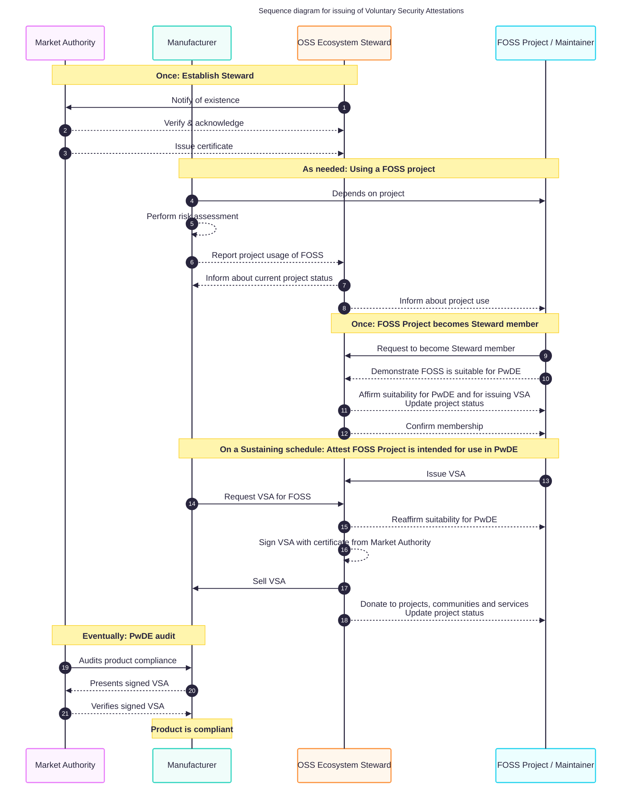

## Summary

The EU Cyber Resilience Act (CRA) makes businesses responsible for the security of _every_ component in their products, including the Open Source ones.
Many of these businesses will need help from the Open Source projects they depend on to become and remain compliant.

The CRA introduces a new kind of organization to provide this help: the _Open Source Software Steward_.
A Steward works well for a foundation supporting tens or hundreds of projects, but an ecosystem like CPAN has _tens of thousands_ of projects, and no existing organization able to take on the role.

This document proposes a new kind of organization, designed for that scale: the **OSS Ecosystem Steward**.

* **Community-owned** – owned by the maintainers, service administrators and community organizers who choose to join.
* **Non-profit** – any surplus goes back to the projects, services and communities in the ecosystem.
* **Co-operative** – democratically governed, with voluntary, opt-in membership that anyone may leave and rejoin.
* **Funded by Manufacturers** – mainly through enrollment fees and recurring _Voluntary Security Attestations_, which help Manufacturers show that the Open Source components they use are suitable for use in their products.

The rest of this document explains why this is needed and how it could work:

1. [Background](#background-the-cra-and-open-source) – what the CRA requires, and what that means for Open Source communities
1. [What is an Open Source Software Steward?](#what-is-an-open-source-software-steward) – and why the role is hard to fill for an entire ecosystem
1. [Designing a Steward for an ecosystem](#designing-a-steward-for-an-ecosystem) – guiding questions and design criteria
1. [The proposal](#the-proposal-a-community-owned-non-profit-co-operative) – a community-owned non-profit co-operative
1. [Funding model](#funding-model) – revenue, expenses, and use of the surplus

## Background: The CRA and Open Source

When the [(EU) Regulation 2024/2847 (Cyber Resilience Act)] comes fully into effect on 11 December 2027, businesses that want to be compliant must perform a number of security-related tasks for each of their CE-marked products, and for the remote data processing solutions those products rely on.

### What is in scope?

The details of what is in scope are beyond this document, but the [CRA Guidance] (e.g. [CRA Guidance chapter 2]) and the [CRA FAQ] (e.g. [CRA FAQ 1.1.2]) cover it in depth.

In short, the CRA applies to _both_ digital and physical products placed on the EU market _in the course of a commercial activity_.
This includes their remote data processing solutions – e.g. online services or APIs the product needs to function as expected.

_This includes phone apps, their server components, and any other services used to keep the product compliant, updated and secure_.

### Obligations that reach upstream Open Source projects

The full list of obligations is laid out in [Article 13], [Article 14], [Article 64], [Article 69], [Annex I, Part I], [Annex I, Part II], [Annex II], and [Annex VII].

The obligations below fall on the Manufacturer, but each has an implication for the Open Source communities upstream of them:

| Obligation on the Manufacturer | Implication for upstream Open Source |
|---|---|
| The product must have a support period that matches its expected use (e.g. 5 years). ([Article 13(8)]) | Any Open Source component used in the product, or in its remote data processing solutions, should be supported for the same period. |
| Security updates must remain available for 5 years after the support period ends. ([Article 13(9)]) | Software update services that depend on Open Source must be kept secure for an _additional 5 years_ – 10 years in total. |
| The product must have no known exploitable vulnerabilities while it is on the EU market. ([Annex I, Part I] (2)(a)) | The product must be updatable for its entire support period, including with relevant updates from its Open Source components. |
| Product metadata (including the SBOM) must be complete, correct and not misleading. ([Article 64(4)]) | Metadata must be kept up to date with changes in upstream projects, e.g. changes in ownership, names, version numbers or schemas. |
| Vulnerabilities and fixes found must be shared with the upstream maintainer. ([Article 13(6)]) | Someone upstream must be there to receive, improve and apply these fixes. |
| The Manufacturer is responsible for the security of the _entire_ product. ([CRA FAQ 4.1.1], [CRA FAQ 4.3.6]) | This _includes_ the Open Source components in the product and in its remote data processing solutions. |
| The Manufacturer must perform a cybersecurity risk assessment, and exercise _due diligence_ when integrating components. ([Article 13], [Article 14]) | Depending on the number of products and their risk profiles, due diligence may cover _hundreds_ or _thousands_ of Open Source components. It also covers the long-term security posture, viability and governance of those components, for the entire support period. |
| Market Surveillance Authorities may evaluate the product, and if corrective action is insufficient, require it to be withdrawn or recalled from the market, or issue fines. ([Article 52], [Article 54]) | If a vulnerability in a product is discovered and exploited before the Manufacturer has its ducks in a row, this can quickly become expensive. |

### The choice facing Open Source communities

From the examples above, we should expect that many businesses using Open Source will be unwilling or unable – or simply lack the resources – to become and remain compliant without at least _a minimum_ of help from the projects and communities they rely on.

This forces Open Source project maintainers, service administrators and community organizers into a [Hobson's Choice]:

1. Either they take steps to demonstrate that their project is _intended for use in the course of a commercial activity_,
1. or they do not – and risk that a (possibly significant) share of their users are forced to switch to alternatives that let them stay compliant.

Declining has security consequences for everyone using the project.
Accepting brings a lot of boring and tedious compliance work.
Neither option is attractive, and in the end, each maintainer has to decide for themselves.

The rest of this document is about making the second option realistic, and fair, for those who choose it.

## What is an Open Source Software Steward?

The CRA defines a new legal category – the _Open Source Software Steward_ – in [Article 3]:

> […] a legal person, other than a manufacturer, that has the purpose […] of _systematically providing support on a sustained basis for the development of […] free and open-source software […] intended for commercial activities, and that ensures the viability of those products.

(See also [Recital (19)], [Article 24], [CRA Guidance chapter 3] and [CRA Guidance section 3.3].)

In practice, the Steward's main purpose is to help Open Source projects improve their long-term security posture, and their viability for use in CE-marked products.

### Why this is hard for an entire ecosystem

For smaller, well-organised communities – e.g. those already supported by a foundation – the Steward's tasks are quite manageable.
Even the largest Open Source foundations support projects numbering in the tens or hundreds.

For an _ecosystem_, the picture is very different.
CPAN alone has _tens of thousands_ of projects, and would struggle to meet even the basic expectations of the CRA described above.

There are two further complications:

* **No existing candidate** – The greater CPAN ecosystem has no existing organization that is willing, competent and able to take on the Steward role.
* **A laissez-faire tradition** – The CPAN community has long operated in a _laissez-faire_ way, letting each individual decide for themselves whether to act or not. Any Steward must respect this.

So instead of trying to fit the Steward's tasks onto existing governance structures, we ask a different question:

**How do we apply the Steward function to an entire _ecosystem_?**

## Designing a Steward for an ecosystem

Our answer is to _create an entirely new organization_, designed from first principles for global, laissez-faire, distributed and heterogeneous communities of communities – like Perl and CPAN.

### Guiding questions

* With awareness of the existing traditions, values, habits and culture of the ecosystem: what type of organization would align best with these?
* What communities, organizations and governance structures exist already, and how can we include them as stakeholders, regardless of their organizational maturity?
* Which communities would also benefit from support, but are usually forgotten?
* How can we make every part of the Steward function _voluntary_ and _opt-in_, so that all parties keep full control and are free to join, leave and rejoin as they wish?
* Which demands on the communities are strictly necessary, and what structures must the Steward have in place to support those demands on a sustained basis?
* How can we minimize the scope and demands placed on projects, and motivate them to take part in the requirements that remain?

### Design criteria

From these questions, we arrive at the following criteria. The Steward should:

1. **Be a non-profit**, dedicated to supporting its communities.
1. **Limit its scope** to projects that are _actually in use_ by Manufacturers (in the CRA sense).
1. **Be able to support others** inside, upstream and downstream of the ecosystem – including projects, services and communities we rely on, but that are easily forgotten or "hidden" in the dependency graph.
1. **Be governed fairly**, through a transparent decision-making structure.
1. **Be freely joinable and leavable** by all community stakeholders.
1. **Work well with outside parties**, and fulfil its obligations towards market surveillance authorities, Manufacturers and others.

## The proposal: A community-owned non-profit co-operative

We propose an _OSS Ecosystem Steward_: a community-owned non-profit co-operative, set up to support the people in the ecosystem who are affected by the CRA, and who wish to help improve their users' compliance situation.

### Community-owned

The project maintainers, service administrators and community organizers who _voluntarily choose to opt in_ become the owners of their Ecosystem Steward.

* **Maintainers** – because the security posture of their projects (and the resulting component releases) is at the centre of the Manufacturers' concerns, and is where Manufacturers are likely to find their largest compliance-related costs.
* **Service administrators** – because Manufacturers and maintainers alike rely on their services to publish, identify, download, resolve, test, discuss and learn about the software they use.
* **Community organizers** – because there is no real Open Source without the meetings, conferences, workshops, summits, tutorials, stands and other venues where networks of trust and support are built.

### Non-profit

Open Source relies heavily on volunteer spirit, and on individual motivation to create something cool or make something cool happen.
In Norway, we call this spirit "Dugnad" or "Dugnadsånd" – the willingness to help your neighbours improve something you share.
Clean up the neighbourhood after a long winter.
Renovate the children's playground.
Or, for your _digital neighbours_: contribute a fix for a vulnerability, organize a conference, or run a service they rely on.

These activities are central to our communities' health, and are almost always done by volunteers.
But some work is hard – even impossible – to find volunteers for, because it is "too boring".
For that work, we need support mechanisms that let people do it anyway – for example funding that makes it possible to spend one weekday (20% FTE) on Open Source.

Many of us contribute to Open Source as a break from corporate and for-profit life.
So the Steward should _not_ support these communities on a for-profit basis.
Instead, it operates as a non-profit: able to fund the "too boring" work, without bringing in the parts of corporate life many of us are trying to get away from.

Conveniently, the CRA also encourages Open Source Software Stewards to operate as non-profits.

### Co-operative

A co-operative is a member-owned legal entity, where any surplus from its operation is used for the benefit of its members.
Co-operatives follow the seven [Rochdale Principles], as formulated by the International Co-operative Alliance:

1. **Voluntary and open membership** – Co-operatives are voluntary organisations, open to all persons able to use their services and willing to accept the responsibilities of membership, without gender, social, racial, political or religious discrimination.
2. **Democratic member control** – Co-operatives are democratic organizations controlled by their members, who actively participate in setting their policies and making decisions. Men and women serving as elected representatives are accountable to the membership. In primary co-operatives members have equal voting rights (one member, one vote) and co-operatives at other levels are also organised in a democratic manner.
3. **Member economic participation** – Members contribute equitably to, and democratically control, the capital of their co-operative. At least part of that capital is usually the common property of the co-operative. Members usually receive limited compensation, if any, on capital subscribed as a condition of membership. Members allocate surpluses for any or all of the following purposes: developing their co-operative, possibly by setting up reserves, part of which at least would be indivisible; benefiting members in proportion to their transactions with the co-operative; and supporting other activities approved by the membership.
4. **Autonomy and independence** – Co-operatives are autonomous, self-help organizations controlled by their members. If they enter into agreements with other organizations, including governments, or raise capital from external sources, they do so on terms that ensure democratic control by their members and maintain their co-operative autonomy.
5. **Education, training, and information** – Co-operatives provide education and training for their members, elected representatives, managers and employees so they can contribute effectively to the development of their co-operatives. They inform the general public – particularly young people and opinion leaders – about the nature and benefits of co-operation.
6. **Cooperation among cooperatives** – Co-operatives serve their members most effectively and strengthen the co-operative movement by working together through local, national, regional and international structures.
7. **Concern for community** – Co-operatives work for the sustainable development of their communities through policies approved by their members.

These principles map directly onto the design criteria above: voluntary membership, fair and democratic governance, and a surplus used for the benefit of the community.

### Legal form

The Ecosystem Steward would do well to be set up as a _European Cooperative Society_ ([Societas cooperativa Europaea (SCE)]).
This lets it operate under a single EEA-wide set of rules, and allows it to move its headquarters to the member state where it is most likely to succeed in its non-profit mission.

### Governance

The governance structure is still to be worked out in detail. The following bodies are referred to elsewhere in this document:

* **General Assembly (GA)** – all members; votes on the budget and on how the surplus is distributed.
* **Board** – elected by the GA (e.g. 5 members); adjusts and proposes the budget.
* **Executive officer (CEO) and treasurer (CFO)** – run the day-to-day operation and draft the budget.

## Funding model

Addressing the CRA's implications should not be expected to happen on a volunteer basis.
The Steward must be able to direct enough funding to its communities that even the "boring" and "tedious" work gets done.

This means that, despite being a non-profit, the Steward has to operate like a regular business, generating a surplus large enough to actually sustain the projects, services and communities in its care.

The funding model has three goals:

1. Operate the Steward so that it generates a surplus, so it can
1. offer support to its members and related communities,
1. in a long-term sustainable way that maintains the security posture Manufacturers need for their products to remain compliant.

### Revenue sources

1. **Public funding** – from funds dedicated to Open Source (e.g. the Sovereign Tech Agency, or similar future funds), during a start-up period.
1. **Enrollment fees** – paid by Manufacturers when enrolling, and when re-enrolling.
1. **Voluntary Security Attestations** – issued on a recurring (subscription) basis; see below.

**The Steward should _not_ accept donations.**
Donations should instead go to other recipients in the community that are set up to accept them – e.g. Perl Monger groups in the donor's regions, The Perl and Raku Foundation (TPRF), or the projects and services the donor relies on.

### Voluntary Security Attestations

A _Voluntary Security Attestation_ (VSA) is a signed statement from the Steward that a given Open Source project is suitable, and intended, for use in _Products with Digital Elements_ (PwDE) – the CRA's term for the products it regulates.
The CRA explicitly opens for such attestation programmes ([Recital (21)], [Recital (117)], [Article 25]).

The life cycle has five phases:

1. **Establishing the Steward (once)** – The Steward notifies a market surveillance authority of its existence. The authority verifies and acknowledges it, and issues a certificate the Steward can sign attestations with.
1. **A Manufacturer starts using a project (as needed)** – The Manufacturer performs a risk assessment, and reports its use of the project to the Steward. The Steward tells the Manufacturer the project's current status, and tells the project that it is in use.
1. **The project joins the Steward (once)** – The project asks to become a member, and demonstrates that it is suitable for use in PwDE. The Steward affirms this, updates the project's status, and confirms the membership.
1. **Attesting the project (on a recurring schedule)** – The Manufacturer requests a VSA for the project. The Steward reaffirms with the project that it is still suitable, signs the VSA, and sells it to the Manufacturer. Part of the proceeds are donated to projects, communities and services in the ecosystem.
1. **Audit (eventually)** – When a market surveillance authority audits the Manufacturer's product, the Manufacturer presents the signed VSA, which the authority can verify.

### Expenses

1. **Staff** (4–9 FTE, including employer's taxes and vacation)
    1. 1–3 Software developers (membership & Manufacturer management; donation management; attestation issuance; etc.)
    1. 1 Primary contact for member communities (member/developer relations and support)
    1. 1 Primary contact for Manufacturers (sales and enrollment support)
    1. 0–1 Primary contact for market surveillance authorities (legal)
    1. 0–1 Training & communications (member security awareness & training)
    1. 0–1 Treasurer & fundraising (CFO)
    1. 1 Executive (CEO)
1. **Variable (income-dependent) operating expenses**
    1. Other
1. **Fixed operating expenses**
    1. Accounting services
    1. Auditing services
    1. Hosting & computer services
    1. Insurance
    1. Legal services
    1. Contingencies & other expenses
1. **Training, education and outreach**
    1. 4–6 external events per employee (travel, lodging, food)
    1. 2 internal events (venue, food, attendee travel & hotel)
    1. Contingencies & other expenses
1. **Board remuneration**
    1. 4 board meetings × 5 board members × 2 hours
1. **Re-investment into the Ecosystem Steward**

The executive officer and treasurer jointly propose the detailed budget to the Board.
The Board may adjust it, and presents the final budget to the General Assembly for a vote.

### Use of surplus

As a non-profit, the Steward must use any surplus on:

1. **Member support donations**, according to a disbursement formula decided by the General Assembly.
1. **Non-member support donations**, according to a disbursement formula decided by the General Assembly.
1. **Re-investment into the Steward**, according to a disbursement formula decided by the General Assembly.

### Example budget

TBD: revenue, expenses and donations.

## References

* [(EU) Regulation 2024/2847 (Cyber Resilience Act)]
* [CRA FAQ] (original source)
* [CRA FAQ - linkable copy] (by the Open Regulatory Compliance Working Group, [ORCWG])
* [CRA Guidance]
* [ORCWG]
* [Hobson's Choice]
* [Rochdale Principles]
* [Societas cooperativa Europaea (SCE)]

[(EU) Regulation 2024/2847 (Cyber Resilience Act)]:https://eur-lex.europa.eu/legal-content/EN/TXT/?uri=OJ:L_202402847 '(EU) Regulation 2024/2847 (Cyber Resilience Act)'
[Regulation (EU) 2019/881, Article (48)]:https://eur-lex.europa.eu/legal-content/EN/TXT/HTML/?uri=CELEX:32019R0881#art_48 'Request for a European cybersecurity certification scheme'

[EU Blue Guide]:https://eur-lex.europa.eu/legal-content/EN/TXT/?uri=uriserv%3AOJ.C_.2022.247.01.0001.01.ENG&toc=OJ%3AC%3A2022%3A247%3ATOC 'The Blue Guide on the implementation of EU product rules (2022/C 247/01)'

[CC-BY-SA-4.0]:https://creativecommons.org/licenses/by-sa/4.0/deed 'Creative Commons Attrubution Sharealike 4.0 License'

[CISA-2023-4]:https://www.cisa.gov/resources-tools/resources/types-software-bill-materials-sbom 'CISA Types of Software Bill of Materials (SBOM)'
[CISA-2024-10]:https://www.cisa.gov/sites/default/files/2024-10/SBOM%20Framing%20Software%20Component%20Transparency%202024.pdf 'CISA Framing Software Component Transparency: Establishing a Common Software Bill of Materials (SBOM)'
[CSCRF]:https://www.sebi.gov.in/legal/circulars/aug-2024/cybersecurity-and-cyber-resilience-framework-cscrf-for-sebi-regulated-entities-res-_85964.html 'Cybersecurity and Cyber Resilience Framework (CSCRF) for SEBI Regulated Entities (REs)'
[TR-03183]:https://bsi.bund.de/dok/TR-03183 'TR-03183 Cyber Resilience Requirements for Manufacturers and Products, Part 2'
[NTIA-SBOM]:https://www.ntia.doc.gov/files/ntia/publications/sbom_minimum_elements_report.pdf#page=9 'NTIA Minimum Elements for a Software Bill of Materials (SBOM)'

[CRA FAQ]:https://digital-strategy.ec.europa.eu/en/library/cyber-resilience-act-implementation-frequently-asked-questions 'FAQs on the CRA implementation'
[CRA FAQ - linkable copy]:https://cra.orcwg.org/faq/official/ 'Linkable version of the Official CRA FAQ by the Open Regulatory Working Group (ORCWG)'
[CRA FAQ 1.1.2]:https://cra.orcwg.org/faq/official/faq_1-1-2/ "What is a product with digital elements? Are stand-alone software or firmware products with digital elements?"
[CRA FAQ 4.1.1]:https://cra.orcwg.org/faq/official/faq_4-1-1/ "What does the CRA require of the manufacturer's cybersecurity risk assessment?"
[CRA FAQ 4.3.6]:https://cra.orcwg.org/faq/official/faq_4-3-6/ 'How should vulnerabilities in integrated components be addressed and remedied?'

[CRA Guidance]:https://digital-strategy.ec.europa.eu/en/library/commission-publishes-new-guidance-support-timely-cyber-resilience-act-implementation 'Commission guidance on the application of the Cyber Resilience Act (CRA)'
[CRA Guidance chapter 2]:https://cra.orcwg.org/official-guidance/#sct_2 'CRA Guidance Chapter 2: Scope'
[CRA Guidance chapter 3]:https://cra.orcwg.org/official-guidance/#sct_3 'CRA Guidance Chapter 3: Free and open-source software'
[CRA Guidance section 3.3]:https://cra.orcwg.org/official-guidance/#sct_3.sct_3 'CRA Guidance Section 3.3: Open-source software stewards'

[ORCWG]:https://orcwg.org/
[ORCWG FAQ]:https://cra.orcwg.org/
[ORCWG copy of the official CRA FAQ]:https://cra.orcwg.org/faq/
[ORCWG copy of the official CRA Guidance]:https://cra.orcwg.org/faq/

[Hobson's Choice]:https://en.wikipedia.org/wiki/Hobson%27s_choice "A Hobson's choice is a free choice in which only one thing is actually offered. The term is often used to describe an illusion that choices are available. The best known example is «I'll give you a choice: take it or leave it», wherein «leaving it» is strongly undesirable."
[Societas cooperativa Europaea (SCE)]:https://en.wikipedia.org/wiki/Societas_cooperativa_Europaea 'A special cooperative entity, that may be set up and operate throughout the European Economic Area, allowing the to move their headquarters freely from one member state to another.'
[Rochdale Principles]:https://en.wikipedia.org/wiki/Rochdale_Principles 'The Rochdale Principles, also known as the seven co-operative principles.'

[Recital (1)]:https://eur-lex.europa.eu/legal-content/EN/TXT/HTML/?uri=OJ:L_202402847#rct_1 'Two major problems adding costs for users and society should be addressed'
[Recital (10)]:https://eur-lex.europa.eu/legal-content/EN/TXT/HTML/?uri=OJ:L_202402847#rct_10 'CRA relevance for supply chains'
[Recital (15)]:https://eur-lex.europa.eu/legal-content/EN/TXT/HTML/?uri=OJ:L_202402847#rct_15 'CRA applies to economic operators that have an intention to monetise a product'
[Recital (18)]:https://eur-lex.europa.eu/legal-content/EN/TXT/HTML/?uri=OJ:L_202402847#rct_18 'Open Source Software Contributors'
[Recital (19)]:https://eur-lex.europa.eu/legal-content/EN/TXT/HTML/?uri=OJ:L_202402847#rct_19 'Open Source Software Stewards, light-touch regulatory regime, and CE mark implications'
[Recital (20)]:https://eur-lex.europa.eu/legal-content/EN/TXT/HTML/?uri=OJ:L_202402847#rct_20 'Open Source package managers considerations as "distributors"'
[Recital (21)]:https://eur-lex.europa.eu/legal-content/EN/TXT/HTML/?uri=OJ:L_202402847#rct_21 'Voluntary security attestation programs for Open Source projects'
[Recital (22)]:https://eur-lex.europa.eu/legal-content/EN/TXT/HTML/?uri=OJ:L_202402847#rct_22 'Submission of SBOMs for Open Source projects'
[Recital (24)]:https://eur-lex.europa.eu/legal-content/EN/TXT/HTML/?uri=OJ:L_202402847#rct_24 'CRA relevance for the NIS2 directive'
[Recital (31)]:https://eur-lex.europa.eu/legal-content/EN/TXT/HTML/?uri=OJ:L_202402847#rct_31 "Manufacturer's liability due to lack of security updates"
[Recital (34)]:https://eur-lex.europa.eu/legal-content/EN/TXT/HTML/?uri=OJ:L_202402847#rct_34 'Exercise due diligence when integrating third-party components'
[Recital (37)]:https://eur-lex.europa.eu/legal-content/EN/TXT/HTML/?uri=OJ:L_202402847#rct_37 'Software for testing purposes, alphas, betas'
[Recital (39)]:https://eur-lex.europa.eu/legal-content/EN/TXT/HTML/?uri=OJ:L_202402847#rct_39 'Continued security updates'
[Recital (41)]:https://eur-lex.europa.eu/legal-content/EN/TXT/HTML/?uri=OJ:L_202402847#rct_41 'Substantial modifications requires a new conformity assessment to be done'
[Recital (43)]:https://eur-lex.europa.eu/legal-content/EN/TXT/HTML/?uri=OJ:L_202402847#rct_43 'Important products with digital elements'
[Recital (44)]:https://eur-lex.europa.eu/legal-content/EN/TXT/HTML/?uri=OJ:L_202402847#rct_44 'Class I and Class II products'
[Recital (45)]:https://eur-lex.europa.eu/legal-content/EN/TXT/HTML/?uri=OJ:L_202402847#rct_45 'Class II products are subject to mandatory third-party conformity assessment'
[Recital (56)]:https://eur-lex.europa.eu/legal-content/EN/TXT/HTML/?uri=OJ:L_202402847#rct_56 'On the download and installation of security updates, and notification of end of support'
[Recital (57)]:https://eur-lex.europa.eu/legal-content/EN/TXT/HTML/?uri=OJ:L_202402847#rct_57 'On the requirement to be able to get security updates separately from functionality updates'
[Recital (60)]:https://eur-lex.europa.eu/legal-content/EN/TXT/HTML/?uri=OJ:L_202402847#rct_60 'Support period'
[Recital (61)]:https://eur-lex.europa.eu/legal-content/EN/TXT/HTML/?uri=OJ:L_202402847#rct_61 'Support period'
[Recital (62)]:https://eur-lex.europa.eu/legal-content/EN/TXT/HTML/?uri=OJ:L_202402847#rct_62 'Support period'
[Recital (63)]:https://eur-lex.europa.eu/legal-content/EN/TXT/HTML/?uri=OJ:L_202402847#rct_63 'Point of contact'
[Recital (64)]:https://eur-lex.europa.eu/legal-content/EN/TXT/HTML/?uri=OJ:L_202402847#rct_64 'Secure by default'
[Recital (65)]:https://eur-lex.europa.eu/legal-content/EN/TXT/HTML/?uri=OJ:L_202402847#rct_65 'Notify of severe incidents or actively exploited vulnerabilities'
[Recital (77)]:https://eur-lex.europa.eu/legal-content/EN/TXT/HTML/?uri=OJ:L_202402847#rct_77 'Manufacturers should facilitate vulnerability analysis by drawing up an SBOM, though they are not obliged to make it public'
[Recital (117)]:https://eur-lex.europa.eu/legal-content/EN/TXT/HTML/?uri=OJ:L_202402847#rct_117 '[…] establish voluntary security attestation programmes for assessing the conformity of products with digital elements qualifying as free and open-source software […]'

[Chapter I]:https://eur-lex.europa.eu/legal-content/EN/TXT/HTML/?uri=OJ:L_202402847#cpt_I 'General Provisions'
[Article 1]:https://eur-lex.europa.eu/legal-content/EN/TXT/HTML/?uri=OJ:L_202402847#art_1 'Subject matter'
[Article 2]:https://eur-lex.europa.eu/legal-content/EN/TXT/HTML/?uri=OJ:L_202402847#art_2 'Scope'
[Article 3]:https://eur-lex.europa.eu/legal-content/EN/TXT/HTML/?uri=OJ:L_202402847#art_3 'Definitions'
[Article 7]:https://eur-lex.europa.eu/legal-content/EN/TXT/HTML/?uri=OJ:L_202402847#art_7 'Important products'
[Article 8]:https://eur-lex.europa.eu/legal-content/EN/TXT/HTML/?uri=OJ:L_202402847#art_8 'Critical products'
[Article 9]:https://eur-lex.europa.eu/legal-content/EN/TXT/HTML/?uri=OJ:L_202402847#art_9 'Obligations of Manufacturers'
[Article 9(1)]:https://eur-lex.europa.eu/legal-content/EN/TXT/HTML/?uri=OJ:L_202402847#art_9.tit_1 'Stakeholder consultation'

[Chapter II]:https://eur-lex.europa.eu/legal-content/EN/TXT/HTML/?uri=OJ:L_202402847#cpt_II 'Obligations of Economic Operators and Provisions in relation to Free and Open-Source Software'
[Article 13]:https://eur-lex.europa.eu/legal-content/EN/TXT/HTML/?uri=OJ:L_202402847#art_13 'Obligations of Manufacturers'
[Article 13(1)]:https://eur-lex.europa.eu/legal-content/EN/TXT/HTML/?uri=OJ:L_202402847#013.001 'Manufacturers shall ensure products are developed in accordance with essential cybersecurity requirements'
[Article 13(2)]:https://eur-lex.europa.eu/legal-content/EN/TXT/HTML/?uri=OJ:L_202402847#013.002 'Manufacturers shall undertake a cybersecurity risk assessment'
[Article 13(5)]:https://eur-lex.europa.eu/legal-content/EN/TXT/HTML/?uri=OJ:L_202402847#013.005 'Manufacturers shall exercise due diligence when integrating components, including FOSS'
[Article 13(6)]:https://eur-lex.europa.eu/legal-content/EN/TXT/HTML/?uri=OJ:L_202402847#013.006 'Manufacturers shall share relevant code or documentation with the supplier or maintainer of the component'
[Article 13(8)]:https://eur-lex.europa.eu/legal-content/EN/TXT/HTML/?uri=OJ:L_202402847#013.008 'Manufacturers shall ensure vulnerabilities are handled for 5 years'
[Article 13(9)]:https://eur-lex.europa.eu/legal-content/EN/TXT/HTML/?uri=OJ:L_202402847#013.009 'Manufacturers shall make security updates available for 10 years or longer'
[Article 13(12)]:https://eur-lex.europa.eu/legal-content/EN/TXT/HTML/?uri=OJ:L_202402847#013.012 'Manufacturers shall before placing a product on the market, draw up technical documentation'
[Article 13(14)]:https://eur-lex.europa.eu/legal-content/EN/TXT/HTML/?uri=OJ:L_202402847#013.014 'Manufacturers shall ensure that procedures are in place for products to remain in conformity with this Regulation'
[Article 13(15)]:https://eur-lex.europa.eu/legal-content/EN/TXT/HTML/?uri=OJ:L_202402847#013.015 'Manufacturers shall ensure that their products is identifiable'
[Article 13(16)]:https://eur-lex.europa.eu/legal-content/EN/TXT/HTML/?uri=OJ:L_202402847#013.016 'Manufacturers shall indicate their name and identification'
[Article 13(17)]:https://eur-lex.europa.eu/legal-content/EN/TXT/HTML/?uri=OJ:L_202402847#013.017 'Manufacturers shall designate a single point of contact for reporting vulnerabilities'
[Article 13(18)]:https://eur-lex.europa.eu/legal-content/EN/TXT/HTML/?uri=OJ:L_202402847#013.018 'Manufacturers shall ensure products are accompanied by documentation listed in Annex II, and available for at least 10 years'
[Article 13(19)]:https://eur-lex.europa.eu/legal-content/EN/TXT/HTML/?uri=OJ:L_202402847#013.019 'Manufacturers shall shall clearly mark the end date of the support period'
[Article 13(20)]:https://eur-lex.europa.eu/legal-content/EN/TXT/HTML/?uri=OJ:L_202402847#013.020 'Manufacturers shall provide a copy of or the exact internet addrees to the EU declaration of conformity'
[Article 14]:https://eur-lex.europa.eu/legal-content/EN/TXT/HTML/?uri=OJ:L_202402847#art_14 'Reporting obligations of manufacturers'
[Article 14(1)]:https://eur-lex.europa.eu/legal-content/EN/TXT/HTML/?uri=OJ:L_202402847#014.001 'A manufacturer shall notify any actively exploited vulnerability contained in the product that it becomes aware of'
[Article 14(2)]:https://eur-lex.europa.eu/legal-content/EN/TXT/HTML/?uri=OJ:L_202402847#014.002 'A manufacturer shall notify within 24 hours, 72 hours and 14 days'
[Article 14(3)]:https://eur-lex.europa.eu/legal-content/EN/TXT/HTML/?uri=OJ:L_202402847#014.003 'A manufacturer shall notify any severe incident having an impact on the security of the product that it becomes aware of'
[Article 14(8)]:https://eur-lex.europa.eu/legal-content/EN/TXT/HTML/?uri=OJ:L_202402847#014.008 'After becoming aware of an incident or vulnerability, the manufacturer shall inform the impacted users of the product, and about risk mitigation and any corrective measures that users can deploy'
[Article 15]:https://eur-lex.europa.eu/legal-content/EN/TXT/HTML/?uri=OJ:L_202402847#art_15 'Voluntary reporting'
[Article 16]:https://eur-lex.europa.eu/legal-content/EN/TXT/HTML/?uri=OJ:L_202402847#art_16 'Establishment of a single reporting platform'
[Article 17]:https://eur-lex.europa.eu/legal-content/EN/TXT/HTML/?uri=OJ:L_202402847#art_17 'Other provisions related to reporting'
[Article 18]:https://eur-lex.europa.eu/legal-content/EN/TXT/HTML/?uri=OJ:L_202402847#art_18 'Authorised representatives'
[Article 19]:https://eur-lex.europa.eu/legal-content/EN/TXT/HTML/?uri=OJ:L_202402847#art_19 'Obligations of importers'
[Article 19(1)]:https://eur-lex.europa.eu/legal-content/EN/TXT/HTML/?uri=OJ:L_202402847#019.001 'Importers shall only place products on the market that comply with requirements in Annex I part I'
[Article 20]:https://eur-lex.europa.eu/legal-content/EN/TXT/HTML/?uri=OJ:L_202402847#art_20 'Obligations of distributors'
[Article 21]:https://eur-lex.europa.eu/legal-content/EN/TXT/HTML/?uri=OJ:L_202402847#art_21 'Cases in which obligations of manufacturers apply to importers and distributors'
[Article 22]:https://eur-lex.europa.eu/legal-content/EN/TXT/HTML/?uri=OJ:L_202402847#art_22 'Other cases in which obligations of manufacturers apply'
[Article 23]:https://eur-lex.europa.eu/legal-content/EN/TXT/HTML/?uri=OJ:L_202402847#art_23 'Identification of economic operators'
[Article 23(2)]:https://eur-lex.europa.eu/legal-content/EN/TXT/HTML/?uri=OJ:L_202402847#023.002 'Be able to present supplier information for 10 years'
[Article 24]:https://eur-lex.europa.eu/legal-content/EN/TXT/HTML/?uri=OJ:L_202402847#art_24 'Obligations of open-source software stewards'
[Article 24(2)]:https://eur-lex.europa.eu/legal-content/EN/TXT/HTML/?uri=OJ:L_202402847#024.002 'Open-source software stewards'
[Article 25]:https://eur-lex.europa.eu/legal-content/EN/TXT/HTML/?uri=OJ:L_202402847#art_25 'Security attestation of free and open-source software shall cooperate with the market surveillance authorities'
[Article 26]:https://eur-lex.europa.eu/legal-content/EN/TXT/HTML/?uri=OJ:L_202402847#art_26 'Guidance'

[Chapter III]:https://eur-lex.europa.eu/legal-content/EN/TXT/HTML/?uri=OJ:L_202402847#cpt_III 'Conformity of the product with digital elements'
[Article 27]:https://eur-lex.europa.eu/legal-content/EN/TXT/HTML/?uri=OJ:L_202402847#art_27 'Presumption of conformity'
[Article 28]:https://eur-lex.europa.eu/legal-content/EN/TXT/HTML/?uri=OJ:L_202402847#art_28 'EU declaration of conformity'
[Article 28(1)]:https://eur-lex.europa.eu/legal-content/EN/TXT/HTML/?uri=OJ:L_202402847#028.001 'Manufacturer states that cybersecurity requirements in [Annex I] has been demonstrated'
[Article 28(4)]:https://eur-lex.europa.eu/legal-content/EN/TXT/HTML/?uri=OJ:L_202402847#028.004 'Manufacturer assumes responsibility for compliance'
[Article 30]:https://eur-lex.europa.eu/legal-content/EN/TXT/HTML/?uri=OJ:L_202402847#art_30 'Rules and conditions for affixing the CE marking'
[Article 30(3)]:https://eur-lex.europa.eu/legal-content/EN/TXT/HTML/?uri=OJ:L_202402847#030.003 'The CE marking shall be affixed before the product with digital elements is placed on the market'
[Article 32]:https://eur-lex.europa.eu/legal-content/EN/TXT/HTML/?uri=OJ:L_202402847#art_32 'Conformity assessment procedures'

[Chapter IV]:https://eur-lex.europa.eu/legal-content/EN/TXT/HTML/?uri=OJ:L_202402847#cpt_IV 'Notification of Conformity Assessment Bodies'
[Article 47]:https://eur-lex.europa.eu/legal-content/EN/TXT/HTML/?uri=OJ:L_202402847#art_47 'Operational obligations of notified bodies'

[Chapter V]:https://eur-lex.europa.eu/legal-content/EN/TXT/HTML/?uri=OJ:L_202402847#cpt_V 'Market Surveillance and Enforcement'
[Article 52]:https://eur-lex.europa.eu/legal-content/EN/TXT/HTML/?uri=OJ:L_202402847#art_52 'Market surveillance and control of products'
[Article 52(3)]:https://eur-lex.europa.eu/legal-content/EN/TXT/HTML/?uri=OJ:L_202402847#052.003 'Market surveillance authorities shall also be responsible for carrying out market surveillance activities in relation to the obligations for open-source software stewards.'
[Article 52(11)]:https://eur-lex.europa.eu/legal-content/EN/TXT/HTML/?uri=OJ:L_202402847#052.011 'Market surveillance authorities shall inform consumers of where to submit complaints that could indicate non-compliance with this Regulation and facilitate reporting of vulnerabilities, incidents and cyber threats'
[Article 54]:https://eur-lex.europa.eu/legal-content/EN/TXT/HTML/?uri=OJ:L_202402847#art_54 'Procedure concerning products presenting a significant cybersecurity risk'
[Article 54(1)]:https://eur-lex.europa.eu/legal-content/EN/TXT/HTML/?uri=OJ:L_202402847#054.001 '[If a market authority finds] sufficient reason to consider that a product, including its vulnerability handling, presents a significant cybersecurity risk, it shall carry out an evaluation of the product concerned in respect of its compliance with all the requirements laid down in this Regulation.'
[Article 54(5)]:https://eur-lex.europa.eu/legal-content/EN/TXT/HTML/?uri=OJ:L_202402847#054.005 '[If the economic operator does] not take adequate corrective action, the market surveillance authority shall take all appropriate provisional measures to prohibit or restrict that product from being made available, to withdraw it from that market or to recall it.'
[Article 58]:https://eur-lex.europa.eu/legal-content/EN/TXT/HTML/?uri=OJ:L_202402847#art_58 'Formal non-compliance'

[Chapter VII]:https://eur-lex.europa.eu/legal-content/EN/TXT/HTML/?uri=OJ:L_202402847#cpt_VII 'Confidentiality and Penalties'
[Article 64]:https://eur-lex.europa.eu/legal-content/EN/TXT/HTML/?uri=OJ:L_202402847#art_64 'Penalties'
[Article 64(4)]:https://eur-lex.europa.eu/legal-content/EN/TXT/HTML/?uri=OJ:L_202402847#064.004 'Supplying incorrect, incomplete or misleading information may be fined up to 5M EUR or 1% of global turnover'
[Article 64(10)(b)]:https://eur-lex.europa.eu/legal-content/EN/TXT/HTML/?uri=OJ:L_202402847#064.010 'Rules on administrative fines shall not apply to Open Source Software Stewards'

[Chapter VIII]:https://eur-lex.europa.eu/legal-content/EN/TXT/HTML/?uri=OJ:L_202402847#cpt_VIII 'Transitional and final provisions'
[Article 69]:https://eur-lex.europa.eu/legal-content/EN/TXT/HTML/?uri=OJ:L_202402847#art_69 'Transitional provisions'
[Article 69(2)]:https://eur-lex.europa.eu/legal-content/EN/TXT/HTML/?uri=OJ:L_202402847#069.002 'Products placed on the market before 11 December 2027 shall be subject to this Regulation only if, from that date, those products are subject to a substantial modification.'
[Article 69(3)]:https://eur-lex.europa.eu/legal-content/EN/TXT/HTML/?uri=OJ:L_202402847#069.003 'Obligations laid down in Article 14 shall apply to all products that fall within the scope of this Regulation that have been placed on the market before 11 December 2027.'
[Article 71]:https://eur-lex.europa.eu/legal-content/EN/TXT/HTML/?uri=OJ:L_202402847#art_71 'Entry into force and application'
[Article 71(2)]:https://eur-lex.europa.eu/legal-content/EN/TXT/HTML/?uri=OJ:L_202402847#071.002 'This Regulation shall apply from 11 December 2027. However, Article 14 shall apply from 11 September 2026 and Chapter IV (Articles 35 to 51) shall apply from 11 June 2026.'

[Annex I]:https://eur-lex.europa.eu/legal-content/EN/TXT/HTML/?uri=OJ:L_202402847#anx_I 'Essential Cybersecurity Requirements'
[Annex I, Part I]:https://eur-lex.europa.eu/legal-content/EN/TXT/HTML/?uri=OJ:L_202402847#d1e47-68-1 'Cybersecurity requirements relating to the properties of products with digital elements'
[Annex I, Part II]:https://eur-lex.europa.eu/legal-content/EN/TXT/HTML/?uri=OJ:L_202402847#d1e143-68-1 'Vulnerability handling requirements'
[Annex II]:https://eur-lex.europa.eu/legal-content/EN/TXT/HTML/?uri=OJ:L_202402847#anx_II 'Information and Instructions to the User'
[Annex III]:https://eur-lex.europa.eu/legal-content/EN/TXT/HTML/?uri=OJ:L_202402847#anx_III 'Important products'
[Annex IV]:https://eur-lex.europa.eu/legal-content/EN/TXT/HTML/?uri=OJ:L_202402847#anx_IV 'Critical products'
[Annex V]:https://eur-lex.europa.eu/legal-content/EN/TXT/HTML/?uri=OJ:L_202402847#anx_V 'EU Declaration of Conformity'
[Annex VII]:https://eur-lex.europa.eu/legal-content/EN/TXT/HTML/?uri=OJ:L_202402847#anx_VII 'Content of the Technical Documentation'
